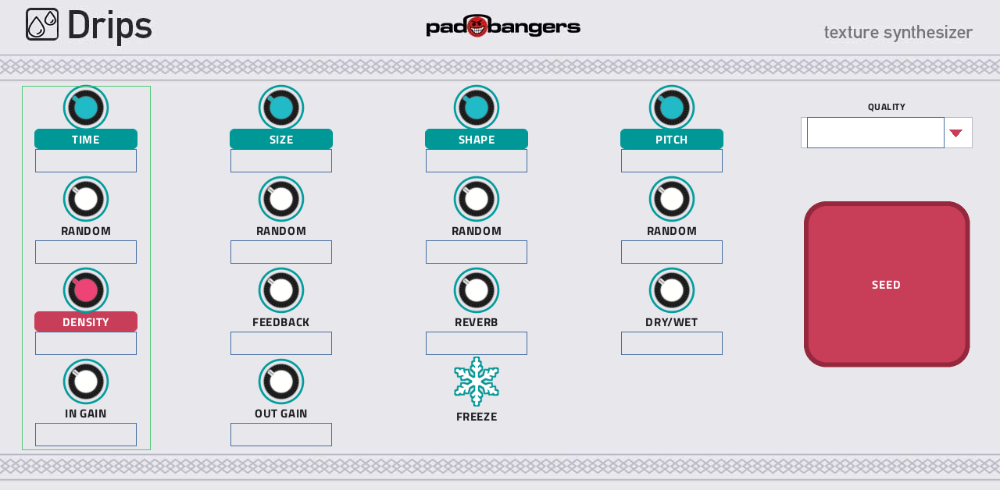
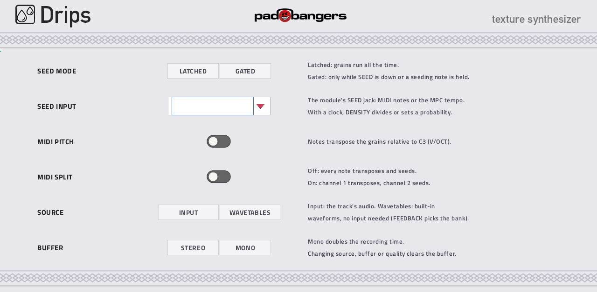
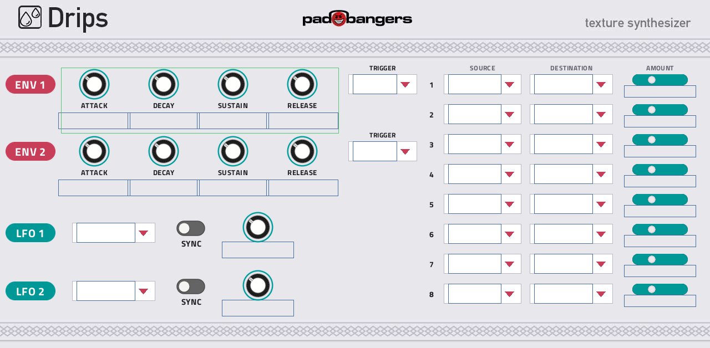
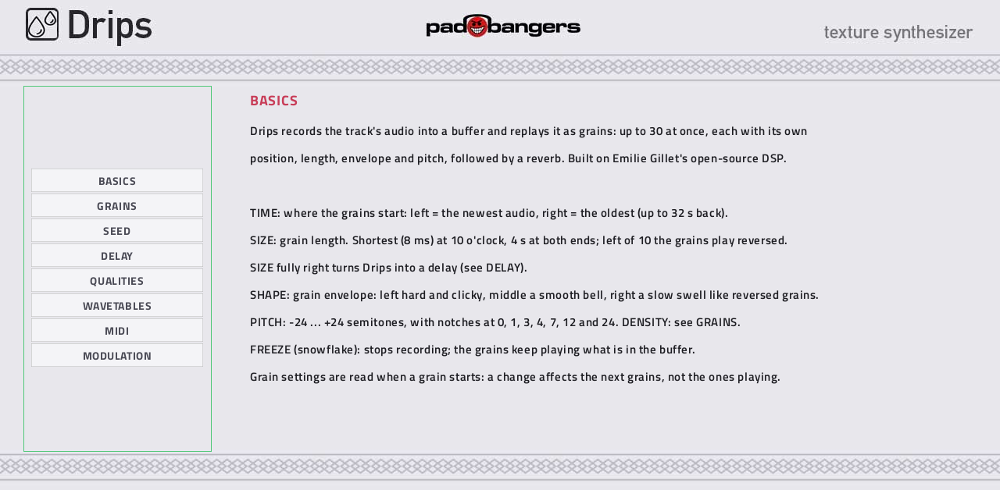

# Drips

**Drips** by Padbangers is a granular texture synthesizer for Akai MPC standalone devices: Mutable Instruments Beads
as a native MPC OS insert effect, with a modulation page on top.

- Records the track into a buffer of 4 to 32 seconds and replays it as up to 30 grains, each with its own position,
  length, envelope, pitch and pan; followed by Beads' reverb.
- **Four recording qualities**, as on the module: Bright Digital (48 kHz 16-bit), Cold Digital (32 kHz 12-bit, the
  Clouds sound), Sunny Tape (24 kHz 12-bit with tape saturation), Scorched Cassette (24 kHz µ-law with wow & flutter).
  Drips runs each at the module's own sample rate.
- **Delay and beat slicer** with SIZE fully clockwise, synced to the MPC tempo if you like.
- **Seed:** latched, gated, clocked by MIDI notes or by the MPC tempo (divider / probability).
- **Wavetable mode:** grains from built-in wavetables, no input needed.
- **Modulation:** two ADSR envelopes, two LFOs (free or tempo-synced) and an 8-slot matrix onto Time, Size, Shape,
  Pitch, Density, Feedback, Dry/Wet, Reverb, Freeze and Seed.
- Play it melodically from a MIDI track, In/Out Gain with an output limiter, Q-Links on every page, a built-in
  manual.






## Requirements

- A first-generation MPC OS standalone device with a 32-bit ARM CPU: **MPC Live / Live II, One, X, Key 61, Force**.
  Developed on an MPC X.
- **Root SSH access** to the device. Stock MPC OS doesn't offer this; you need a modded unit.
- Installing plugins this way is unofficial. Back up your projects and use it at your own risk.

## Using it

**DRIPS tab.** A 4×4 block (Time Size Shape Pitch / Random ×4 / Density Feedback Reverb Dry/Wet / In Gain Out Gain
Freeze), Quality and a big SEED pad on the right. Q-Links:

| | | | |
|---|---|---|---|
| Time | Size | Shape | Pitch |
| Random | Random | Random | Random |
| Density | Feedback | Reverb | Quality |
| In Gain | Out Gain | Freeze | Dry/Wet |

The Random knobs are Beads' attenurandomizers. **SETTINGS tab:** Seed Mode, Seed Input, MIDI Pitch, MIDI Split, Source,
Buffer, each with a short explanation.

**MIDI:** MPC OS sends no MIDI to insert effects, so every Drips instance opens its own MIDI input, **Drips 1**,
**Drips 2**, … Set a MIDI track's output to it. Notes play the module's two jacks: PITCH (V/OCT, relative to C3)
(with MIDI Pitch on) and, with SEED INPUT = MIDI, SEED (grains, bursts, delay taps). With **MIDI Split** on, channel 1
only transposes and channel 2 only seeds: one track for the melody, one for the rhythm.

**MANUAL tab:** basics, grains, seed, delay, qualities, wavetables, MIDI and modulation, on the device.

## Build from source

Needs Docker (with QEMU for 32-bit ARM containers), Python 3 and bash ≥ 4. The plugin framework is a submodule:

```sh
git clone --recursive <this repo>
cd drips
./build.sh            # -> build/drips.so + skin
make -C test run      # native engine test
./deploy.sh <host>    # copy to a device over ssh (--yes also registers it; restarts MPC)
```

Developer notes and design decisions: [`CLAUDE.md`](CLAUDE.md).

## Credits and licenses

- Drips: MIT, see [`LICENSE`](LICENSE).
- Beads DSP and stmlib by Emilie Gillet — MIT, vendored in `third_party/beads/`.
- Plugin framework: [sd88me/mpc-vst-plugins](https://github.com/sd88me/mpc-vst-plugins) (submodule; build-time only).
- Not affiliated with Mutable Instruments or Akai Professional.
